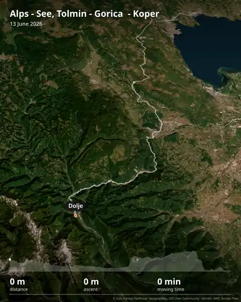
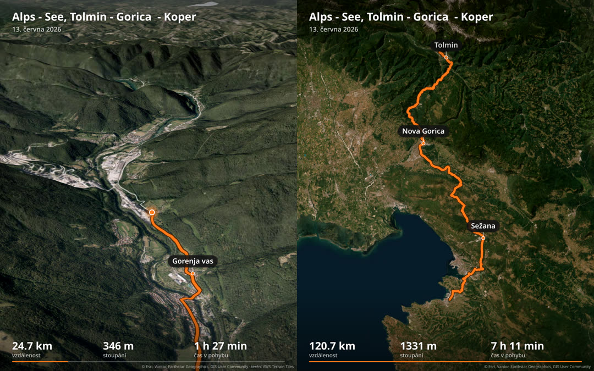

# Trail Flyover

[](https://github.com/zpracny/trail-flyover/actions/workflows/ci.yml)

[English](README.md) · **Česky**

Plynulý 3D průlet nad GPS trasou: náhled v prohlížeči a export videa MP4/WebM pro sociální sítě.
Komponenta nezávislá na frameworku, postavená na MapLibre GL. Je určená k použití v TrailMetrics i NaBrdy.

**[▶ Vyzkoušej živé demo](https://zpracny.github.io/trail-flyover/)** s ukázkovou trasou nebo vlastním GPX.



Prvních pár sekund videa vyexportovaného z dema
([celé video, 24 s, MP4](https://github.com/zpracny/trail-flyover/releases/download/v0.2.2/trail-flyover-example.mp4)).

## Požadavky

- **Prohlížeč** s WebGL 2 a pro export videa s WebCodecs: Chrome, Edge, Firefox 130+, Safari 16.4+.
- **Node.js 22.18 nebo novější**: testy a skripty běží přímo z TypeScriptu, bez překladu.
- **Python 3** jen pro demo server (`npm run serve`).
- Žádné API klíče ani proměnné prostředí: všechny vestavěné podklady jsou bez klíče.

## Vyzkoušení

```
git clone https://github.com/zpracny/trail-flyover.git && cd trail-flyover
npm ci
npm run build && npm run serve      # demo na http://127.0.0.1:8811
npm run check                       # typy, linter (Biome) a testy
npm run build:lib                   # balíček pro aplikace: dist/ (JavaScript a typové deklarace)
npm run compare                     # srovnání plynulosti se současnou kamerou TrailMetrics
```

Testy: 99 testů za ~10 s na skutečném záznamu 121 km, jeho 46km úseku a na umělých i náhodných
trasách. Stejnou kontrolu spouští GitHub Actions u každého pushe.

## Instalace do aplikace

Balíček zatím není na npm. Instaluje se vydaná verze z GitHubu, `maplibre-gl` (5 a novější)
dodává aplikace:

```
npm install https://github.com/zpracny/trail-flyover/releases/download/v0.4.1/trail-flyover-0.4.1.tgz maplibre-gl
```

Je to hotový přeložený balíček (ES moduly s typovými deklaracemi v `dist/`), v lockfile připnutý
kontrolním součtem. Funguje i instalace přímo z gitu
(`npm install github:zpracny/trail-flyover#v0.4.1`); npm pak balíček při instalaci sestaví.
Na sestavovacích serverech je lepší balíček z vydání: instalaci z gitu npm zapíše jako
`git+ssh://`, a ta tam potřebuje SSH klíč.

Ověřeno: typová kontrola v TypeScriptu 5.7 (`moduleResolution: "bundler"`, se `strict` i bez),
sestavení přes esbuild, import jádra v Node. Zatím nezkoušeno: úplné sestavení v Next.js nebo Vite.
`transpilePackages` by nemělo být potřeba, balíček obsahuje přeložený JavaScript.

## Proč je to plynulé

Současný 3D Fly-over v TrailMetrics (`components/StoryGenerator/story3DCamera.ts`) cuká ze tří důvodů:

| Problém | Příčina | Řešení zde |
|---|---|---|
| Otáčení pulzuje | směr se mezi 150 klíčovými snímky prolíná smoothstepem, takže úhlová rychlost klesne u každého snímku na nulu (~5× za sekundu) | žádné klíčové snímky: směr je tečna vyhlazené dráhy a v čase se ještě vyhladí s omezením na 32 °/s |
| Dráha se láme | střed se mezi klíčovými snímky prokládá přímkami ze syrových GPS bodů | převzorkování po stejné vzdálenosti a Gaussovo vyhlazení bez zpoždění, okno úměrné vzdálenosti kamery |
| Náhled seká | každý snímek čeká na `GeoJSONSource.setData` (worker, nepravidelná doba) | trasa je rozdělená na úseky odkrývané přes `feature-state` (synchronní), kamera a `map.redraw()` ve stejném snímku |
| Kamera poskakuje | MapLibre bere výšku středu z právě načtených dlaždic terénu | výška kamery z vlastního, předem vyhlazeného DEM; `centerClampedToGround: false` |

Naměřeno `npm run compare` na skutečné trase z `test/fixtures`:

| trasa, video | max. zrychlení otáčení: TM nyní → nově | lom dráhy p99: TM nyní → nově |
|---|---|---|
| 121 km (Tolmin–Koper), 30 s | 358 → 16 °/s² | 29° → 1,0° za snímek |
| 121 km (Tolmin–Koper), 60 s | 97 → 13 °/s² | 22° → 1,3° |

Úvod a závěr letí po křivce van Wijka a Nuije (princip `flyTo`): dlouhý přesun proběhne ve výšce
a přiblížení až u cíle. Délka úvodu a závěru se řídí poměrem přiblížení (121km trasa: 119 km → 7,3 km
dostane 6 s), aby logaritmické zrychlení přiblížení nepřesáhlo ~0,6 /s².

**Čelo trasy zůstává v záběru.** Vyhlazená dráha kamery řeže zatáčky až o 0,2 vzdálenosti kamery.
Ve formátu 9:16 je to víc než polovina šířky obrazu, takže čelo trasy dřív vyjíždělo až za okraj.
Teď kamera v takovém místě plynule ustoupí do strany (čelo se drží do 58 % šířky) a v úzkém
formátu letí o 30 % dál. Test to hlídá pro všechny trasy, kamery a poměry stran.

**Přehled využívá celý obraz.** Úvodní a závěrečný záběr se běžně dívá ve směru jízdy. Když by ale
protáhlá trasa ležela v obraze napříč (severojižní trasa ve formátu Story), natočí se kamera až
o 90° tak, aby trasa byla co největší. Otočení se rozloží do celého úvodu nebo závěru.

## Architektura

```
src/core/        čisté výpočty, bez DOM (testované v Node)
  flightPlan.ts  trasa → plán letu: poseAt(t), distanceAt(t), statsAt(t)
  geo.ts         projekce, převzorkování, Gaussovo vyhlazení, úhly
  gpx.ts         čtení GPX (bez DOMParseru): body trasy, název, pojmenované waypointy
  clean.ts       vyřazení chyb GPS (skoky, 0°/0°), trasy přes 180. poledník
  terrarium.ts   synchronní DEM z dlaždic AWS Terrarium (zdarma, bez klíče)
src/maplibre/
  player.ts      TrailFlyover: náhled, přednačtení, export
  basemaps.ts    mapové podklady jako data
src/hud/hud.ts   štítky míst, čelo trasy, výchozí panel se statistikami
src/effects/     zimní filtr (přebarvení dlaždic)
src/export/      kódování snímek po snímku přes WebCodecs (mediabunny)
src/extras/      názvy míst z OpenStreetMap (vektorové dlaždice nebo Overpass), volitelné
```

**Kamera je čistá funkce času.** Plán letu se spočítá jednou, pak `poseAt(t)` vrací polohu kamery
a cíle. Náhled i export volají totéž, takže video vypadá přesně jako náhled.

Let má tři fáze: úvodní přehled celé trasy, průlet za čelem trasy s plynulým rozjezdem a dojezdem
a závěrečný přehled s mírným kroužením. Přehledy se počítají přesně: virtuální kamera promítne
všechny body trasy a binárním hledáním se najde nejbližší vzdálenost, při které se trasa vejde mezi
titulek a panel se statistikami. Tuhle vlastnost hlídá test pro všechny tři poměry stran.

## Použití

```ts
import maplibregl from 'maplibre-gl';
import { TrailFlyover, parseGpx } from 'trail-flyover';

const fly = new TrailFlyover(element, {
    maplibregl,                                  // vlastní instance aplikace (žádná druhá kopie)
    output: { width: 1080, height: 1920 },       // Story; Feed 1080×1350, Wide 1920×1080
    basemap: 'esri-satellite',                   // nebo 'cuzk-ortofoto', 'esri-light', vlastní BasemapDef…
    flight: { preset: 'drone', duration: 30 },   // drone | low | overview; camera: 'static' = celá trasa
    labels: [{ lon: 13.733, lat: 46.183, name: 'Tolmin', kind: 'town' }],   // ukážou se jen ta na trase
    locale: 'cs',                                // texty panelu česky (výchozí je angličtina)
});
await fly.load(parseGpx(gpxText).points, { title: 'Tolmin – Koper', subtitle: '13. června 2026' });

fly.play();                                      // náhled v reálném čase
await fly.prefetch(p => console.log(p));         // volitelně: dlaždice předem, pak přehrávání bez děr
const video = await fly.exportVideo({ format: 'mp4', fps: 30, onProgress });
const photo = await fly.exportImage();
fly.on('time', t => …); fly.on('state', s => …);
fly.destroy();
```

### Chování při souběhu

Přehrávač počítá s tím, že ho aplikace volá rychle za sebou (posuvníky, efekty v Reactu):

- `load()` a `update()` se řadí za sebe. Při několika `load()` po sobě se postaví jen poslední
  trasa, starší volání se dokončí bez práce.
- `update()` jde volat ještě během `load()`. Neplatná změna (neznámý podklad, chybějící klíč)
  skončí chybou a nic nezmění.
- Během exportu a přednačítání `load()`, `update()` a další export skončí chybou „An export or prefetch is in progress…“.
  `seek()` a `play()` se v té době ignorují.
- Během exportu a přednačítání ukazuje přehrávač stojící obraz z okamžiku spuštění: mapa pod ním
  skáče ze snímku na snímek a čeká na dlaždice, což by vypadalo trhaně. `stillWhileBusy: false`
  ukáže práci naživo.
- `prefetch()` je pro plynulé **přehrávání**. Export ho nepotřebuje: na každou dlaždici každého
  snímku stejně počká.
- `destroy()` jde zavolat kdykoli, i uprostřed načítání nebo exportu. Rozpracované načítání se
  zahodí a nevznikne žádná mapa navíc; export skončí chybou `AbortError`.
- Nedostupná nebo chybějící dlaždice nezpůsobí chybu `load()`. Mapa se dokreslí, jakmile dlaždice
  dorazí.

### Vlastní HUD (TrailMetrics)

TrailMetrics má velké statistiky pro sociální sítě. Místo výchozího panelu předá vlastní funkci.
Štítky míst a čelo trasy kreslí přehrávač dál:

```ts
new TrailFlyover(el, {
    maplibregl,
    hud: (ctx, f) => {
        // f.width, f.height, f.scale (min(w,h)/1080), f.stats.distance / ascent / moving / elapsed,
        // f.total, f.progress, f.project(lon, lat) → bod v pixelech výstupu
        drawTrailMetricsStats(ctx, f);
    },
});
```

### Zastávky: pozastavení letu kvůli fotce

Letu jde zadat místa, kde se má zastavit. Linka i kamera plynule zpomalí, zadanou dobu stojí
a zase se rozjedou; co se tam má ukázat (karta s fotkou, poznámka), nakreslí aplikace ve své
funkci `hud`.

```ts
const fly = new TrailFlyover(el, {
    maplibregl,
    flight: {
        duration: 30,                                   // samotný let; zastávky se přičítají
        stops: [
            { time: photo.takenAt, duration: 3, data: photo },          // podle času záznamu…
            { lon: 13.65, lat: 45.96, duration: 5, data: gallery },     // …podle místa (první průjezd do 500 m)…
            { distance: 60_000, duration: 2 },                          // …nebo podle metrů od startu
        ],
    },
    hud: (ctx, f) => {
        drawMyStats(ctx, f);
        if (f.stop) {
            // f.stop.stop.data je to, co jsi předal; elapsed / remaining / progress říkají, kde v zastávce jsme
            const alpha = Math.min(1, f.stop.elapsed / 0.5, f.stop.remaining / 0.5);   // prolnutí
            drawPhotoCard(ctx, f.stop.stop.data, alpha);
        }
    },
});
```

- Video trvá `duration` plus součet zastávek (`fly.duration` je celková délka).
- Zastávky, které nejde umístit (čas mimo záznam, místo dál než `stopMaxOffTrack` od trasy, žádná
  délka), se vynechají; `fly.flightPlan.stops` vypíše ty použité v pořadí, v jakém k nim linka
  dojede, s časy `start` a `end`.
- Kamera se po zastavení linky ještě chvilku usazuje, uprostřed zastávky stojí.
- Zastávky fungují s každou kamerou, i se statickým pohledem na celou trasu.

### Graf převýšení

`elevationProfile: true` přidá profil do vestavěného panelu. S vlastním `hud` ho nakresli, kam chceš:

```ts
import { drawElevationProfile } from 'trail-flyover';

hud: (ctx, f) => {
    drawElevationProfile(ctx, f, { x: 60, y: f.height - 320, width: f.width - 120, height: 120 });
    // f.profile obsahuje data (pole vzdáleností a výšek, min, max) pro vlastní kreslení
}
```

### Místo pro vlastní panely

Záběry na celou trasu (přehledy a statická kamera) drží trasu mimo panely. Když jsou tvoje větší
než vestavěné, nebo chceš respektovat bezpečné zóny sociální sítě, řekni, kolik obrazu nechat volné:

```ts
flight: { margins: { top: 0.2, bottom: 0.3, side: 0.07 } }   // zlomky výšky / šířky
```

### Jazyk

Vestavěný panel a stavové hlášky jsou anglicky; `locale: 'cs'` je přepne do češtiny
a `strings: { distance: 'Strecke', … }` nahradí jednotlivé texty. Chyby pro vývojáře jsou vždy
anglicky.

### React / Next.js

Komponenta pracuje s DOM a WebGL, takže v Next.js patří do client komponenty:

```tsx
'use client';
import { useEffect, useRef } from 'react';
import maplibregl from 'maplibre-gl';
import 'maplibre-gl/dist/maplibre-gl.css';
import { TrailFlyover, type TrackPoint } from 'trail-flyover';

export function Flyover({ points, title }: { points: TrackPoint[]; title: string }) {
    const ref = useRef<HTMLDivElement>(null);
    const fly = useRef<TrailFlyover | null>(null);
    useEffect(() => {
        if (!ref.current) return;
        const f = new TrailFlyover(ref.current, { maplibregl });
        fly.current = f;
        f.load(points, { title }).catch(err => console.error(err));
        return () => {
            f.destroy();
            fly.current = null;
        };
    }, [points, title]);
    return <div ref={ref} style={{ width: '100%', aspectRatio: '4 / 5' }} />;
}
```

`destroy()` je bezpečné zavolat i uprostřed `load()`, takže dvojí spuštění efektu ve vývojovém
režimu Reactu nevadí.

## Tři režimy sdílení (a čtvrtý navíc)

Odpovídají režimům sdílení trasy v TrailMetrics; liší se jen dvěma volbami.



| Režim | Co dělá | Nastavení |
|---|---|---|
| **Celá trasa** | mapa stojí, je vidět celá trasa a běží jen linka | `mode: '2d', flight: { camera: 'static' }` |
| **Let nad mapou** | 2D mapa se plynule posouvá s trasou, sever nahoře | `mode: '2d'` |
| **Průlet 3D** | terén, nakloněná kamera letí s trasou | výchozí |
| Celá trasa 3D | nakloněný pohled na celou trasu s terénem, běží jen linka | `flight: { camera: 'static' }` |

Statická kamera (`camera: 'static'`):

- Záběr je spočítaný přesně tak, aby se celá trasa vešla mezi titulek a panel se statistikami.
- Ve 2D je sever nahoře. Ve 3D, nebo s `northUp: false`, se pohled natočí, když se tím trasa
  výrazně zvětší (východozápadní trasa ve formátu Story).
- Video je kratší: 8 s + 0,15 s/km, nejvýš 24 s. `intro` je doba, po kterou je vidět prázdná
  mapa, `outro` doba, po kterou zůstane hotová linka.
- Délku jde nastavit od 3 s (`flight.duration`), u každé kamery.
- Malá místa po 3,5 s zase zmizí, města zůstávají jako orientační body.

## Názvy míst

Předané štítky (`labels`) se neukazují všechny. Zůstanou jen místa, kterými trasa opravdu vede,
a každé se objeví ve chvíli, kdy k němu čelo trasy dojede (ne dřív).

- **Dosah podle druhu místa** (`labelReach`, výchozí `LABEL_REACH`): město do 1 000 m (bod města
  je jeho střed a trasa ho může míjet po okraji), vesnice 400 m, samota 250 m, vrchol 250 m,
  vlastní bod (`kind: 'waypoint'`) 1 500 m. Jde zadat jedno číslo pro všechno, nebo jen některé
  druhy: `labelReach: { village: 800 }`.
- **Tempo** (`labelMinGap`, výchozí 0,6 s): když jdou místa rychle za sebou (shluk samot při
  rychlém průletu), méně důležitá se vynechají. Města zůstávají vždy. `0` ukáže všechno.
- Místo, ve kterém trasa začíná, je vidět od prvního snímku.
- Kde by se štítky překrývaly, má přednost důležitější a pak dřív projeté místo. Střídají se
  prolnutím, ne skokem; u okraje obrazu štítek plynule mizí.
- V přehledových záběrech na začátku a na konci průletu zůstávají jen města — a **start a cíl**.
- **Start a cíl** (`keepEndpointLabels`, výchozí true): nejbližší obec, osada nebo město do
  `endpointRadius` (3000 m) od prvního a od posledního bodu trasy zůstává jako orientační bod,
  i v přehledech. Rozhoduje vzdálenost od koncového bodu: jízda, která skončí po odbočce tam
  a zpět do jiné vesnice, končí tam, kde je její poslední bod. Okruh ukáže své místo jednou.
- **Vlastní značky**: štítek může mít vlastní `color` (tečka) a `icon` (krátký text nebo emoji
  před názvem), např. `{ name: 'Sněžka', kind: 'peak', color: '#f97316', icon: '▲', priority: 5 }`.
  S `priority` 4 a víc je štítek orientační bod: nikdy se nevynechá a zůstává i v přehledech.

Na trase Tolmin–Koper (253 míst z OpenStreetMap v okolí) zůstane v dosahu 68 míst;
při 60s průletu se jich ukáže 31, při 24s statickém záběru 19.

### Názvy míst z OpenStreetMap

`fetchPlaceLabels(points)` čte názvy měst, obcí, osad a vrcholů z **vektorových dlaždic** ve
schématu OpenMapTiles (vrstvy `place` a `mountain_peak`), výchozí zdroj je
[OpenFreeMap](https://openfreemap.org): zdarma, bez klíče, z CDN, při jakémkoli podkladu (dlaždice
se stahují jen kvůli názvům). Funguje v prohlížeči i v Node ≥ 22.

```ts
import { fetchPlaceLabels, PlaceLabelsError } from 'trail-flyover';

let places;
try {
    places = await fetchPlaceLabels(points);
} catch (err) {
    // Některé dlaždice selhaly i napodruhé; err.labels má, co daly ostatní.
    if (err instanceof PlaceLabelsError) places = err.labels; else throw err;
}
flyover.load(points, { labels: places });
```

- Stahují se jen dlaždice do `maxOffTrack` (2 km) od trasy, paralelně: 50km jízda je na zoomu 12
  zhruba 15–30 dlaždic po ~50 kB, hotovo pod sekundu. Dlouhé trasy sníží zoom, aby nepřekročily
  `maxTiles` (200).
- `zoom` (12): všechna města, městyse a obce; osady také, jen v nejhustších oblastech dlaždice
  vynechají ty nejméně důležité. Na trase Tolmin–Koper ukáže zoom 12 ze 68 míst od Overpassu 67
  (chybí jeden vrchol), zoom 11 jen 41.
- `language` upřednostní `name:{language}`, jinak místní název (výchozí).
- `kinds` (city, town, village, hamlet), `peaks` (true), `concurrency` (6), `timeoutMs` (10000),
  `signal`.
- `tiles` (šablona `{z}/{x}/{y}`) nebo `tileJson` ukážou na jiný zdroj OpenMapTiles (MapTiler,
  vlastní server). Z požadavků na dlaždice server pozná, kde přibližně jízda byla.
- Chyba nikdy nezapadne: dlaždice, která selže dvakrát, vyhodí `PlaceLabelsError` s `labels`
  (z dlaždic, které se načetly), `failedTiles` a `totalTiles`.
- K videu patří atribuce `OPENFREEMAP_ATTRIBUTION` („OpenFreeMap © OpenMapTiles Data from
  OpenStreetMap“). S Content Security Policy povolte `https://tiles.openfreemap.org` v `connect-src`.

`fetchPlaceLabels(points, { source: 'overpass' })` (nebo `fetchOverpassPlaceLabels`) se místo
toho ptá Overpass API, které bývá přetížené (odpověď za desítky sekund, nebo vůbec).

## Mapové podklady

| id | Popis | Klíč | Sdílení videa | Otestováno |
|---|---|---|---|---|
| `esri-satellite` | Esri World Imagery, celý svět (letní snímky) | ne | osobní, nevýdělečné | ✅ |
| `cuzk-ortofoto` | ČÚZK Ortofoto, nejostřejší v ČR (letní); za hranicí se podkládá Esri (`fallback`) | ne | volné (CC BY 4.0) | ✅ |
| `esri-wayback-2022` | archiv Esri 2022: skutečný zimní snímek, sníh ale jen místy (Špičák, Železná Ruda) | ne | osobní, nevýdělečné | ✅ |
| `esri-topo` | turistická mapa Esri, rychlý server | ne | osobní, nevýdělečné | ✅ |
| `opentopomap` | turistická OpenTopoMap; pomalý server (dlaždice až 8 s) | ne | volné (CC BY-SA) | ⚠️ pomalé |
| `esri-satellite-bw` | černobílý satelit (tentýž snímek Esri bez barev) | ne | osobní, nevýdělečné | ✅ |
| `esri-light` | černobílá mapa: světle šedý podklad bez popisků, terén stínováním | ne | osobní, nevýdělečné | ✅ |
| `esri-dark` | tmavý podklad se stínováním terénu | ne | osobní, nevýdělečné | ✅ |

Žádný vestavěný podklad nepotřebuje API klíč. Vlastní podklad s klíčem jde přidat přes
`BasemapDef.requiresKey` a `apiKeys`.

### Licence a sdílení videa (stav 11/2026)

Sloupec „Sdílení videa“ je i v datech (`BasemapDef.sharing`); přehrávač nic neblokuje, demo jen
ukáže upozornění. Není to právní rada, jen shrnutí podmínek, které jsem četl.

- **ČÚZK Ortofoto** je od 1. 7. 2023 otevřená data pod CC BY 4.0. Stačí „© ČÚZK“, které je ve
  videu. Nejčistší volba pro Česko.
- **Esri**: podmínky pro statické mapy (snímky obrazovky a podobně) dovolují osobní užití
  a propagaci vlastních produktů s uvedením zdroje; pro „commercial monetization“ je potřeba
  souhlas. Video ani sociální sítě výslovně nezmiňují. Vrstvy (World Imagery, World Topo Map) se
  řídí licenční smlouvou Esri (Master License Agreement) a podle podmínek u položky nejsou určené
  k exportu dlaždic pro offline použití; průběžné stahování při náhledu a exportu videa je
  běžné zobrazení. Atribuce ve videu odpovídá tomu, co služby samy uvádějí.
- **Esri v produkci (k ověření):** dokumentace pro vývojáře u současných služeb podkladů
  (Basemap Styles, Static Basemap Tiles) vyžaduje účet ArcGIS Location Platform a přístupový
  token. Adresy `server.arcgisonline.com`, které tu používám, v ní zmíněné nejsou. Pro veřejnou
  aplikaci s mnoha uživateli (TrailMetrics) proto doporučuju účet a token a podklady předat jako
  vlastní `BasemapDef` s `requiresKey`; kolik je zdarma, se mi z ceníku zjistit nepodařilo.
- **Mapy.com mezi podklady záměrně nejsou.** Podmínky API (od 1. 6. 2025, čl. 4.6.2) zakazují
  dlaždice a výstupy ukládat, exportovat a sdílet a atribuce vyžaduje klikací logo nad mapou, což
  ve videu nejde. Export videa na sociální sítě by tak potřeboval písemný souhlas Seznamu.
- **OpenTopoMap** je CC BY-SA, ale server je pomalý a na hromadné stahování není určený.

Zdroje: [podmínky Mapy.com API](https://developer.mapy.com/terms-and-conditions/),
[atribuce Mapy.com](https://developer.mapy.com/rest-api-mapy-cz/atribution/),
[Esri – statické mapy](https://doc.esri.com/en/arcgis-online/latest/reference/static-maps.html),
[Esri – Static Basemap Tiles](https://developers.arcgis.com/documentation/mapping-and-location-services/mapping/basemaps/introduction-static-basemap-tiles-service/),
[ČÚZK – otevřená data](https://www.cuzk.gov.cz/Uvod/Produkty-a-sluzby/Otevrena-data/Otevrena-data-zakladni-informace.aspx).

### Zasněžená krajina

Souvislý zasněžený letecký snímek v dobrém rozlišení zdarma neexistuje: Esri i ČÚZK fotí v létě,
zimní Sentinel-2 má 10 m/px a chce registraci. Archiv Esri Wayback jsem prošel automaticky
(199 verzí). Zimní snímek má jen verze 2021–2022, a to jen místy.

Proto je tu **zimní filtr** (`snow`), který zasněží libovolný podklad: louky, pole a střechy zbělají,
lesy zůstanou tmavé s jinovatkou a voda tmavá. Volitelná sněhová čára podle DEM nechá údolí zelená:

```ts
new TrailFlyover(el, { maplibregl, basemap: 'cuzk-ortofoto', snow: { snowline: 900 } });
fly.update({ snow: false });   // vypnout
```

Funguje přes vlastní protokol v MapLibre (`addProtocol`), takže se dá zapnout nad kterýmkoli
podkladem. Přepočet pixelů je čistá funkce `snowifyPixels`, otestovaná v Node.

## 2D mapa

Stejný plán letu funguje i na 2D mapě: `mode: '2d'` vypne terén a oblohu, kamera se dívá kolmo
dolů, sever je nahoře (`flight.northUp`, lze vypnout pro otáčení po směru jízdy). S
`flight.camera: 'static'` mapa stojí a běží jen linka (viz režimy výše). Plynulost, úvod
a závěr, štítky, HUD i export zůstávají stejné. Jádro (`buildFlightPlan` s `preset: 'topdown'`) lze
použít i bez přehrávače, třeba pro animaci trasy v interaktivní mapě NaBrdy přes `map.jumpTo` nebo
pro 2D Story v TrailMetrics, který kreslí do canvasu.

Vlastní podklad je obyčejný objekt `BasemapDef` (URL dlaždic, atribuce, úpravy barev). Atribuci
kreslí HUD i do videa.
Terén je vždy AWS Terrain Tiles (Terrarium, zdarma).

## Vstupní data

- **Vzdálenost** je přesný součet původních bodů záznamu (ne vyhlazené dráhy), takže sedí s tím,
  co ukazuje aplikace (u testovací trasy Tolmin–Koper 120,7 km).
- **Čas v pohybu** (`stats.moving`) vynechává zastávky; `stats.elapsed` je celkový čas záznamu.
  Tolmin–Koper: 7 h 11 min v pohybu z 9 h 08 min. Výchozí panel ukazuje čas v pohybu.
- **Chyby GPS** se před výpočtem vyřadí: skok pryč a zpět rychlostí nad 180 km/h, bod 0°/0°,
  nesmyslné souřadnice a osamělý první nebo poslední bod daleko od trasy. Skok, který se nevrátí
  (pozastavený záznam, vlak), zůstává. Bez časových značek se skoky neposuzují.
- Trasy přes 180. poledník a na jižní i západní polokouli fungují (testováno).
- Pojmenované waypointy z GPX (`parseGpx(...).waypoints`) jdou rovnou použít jako štítky.

## Výkon (naměřeno na Intel Iris Xe, náhled 720×900)

Měřeno na dvou trasách, které nejsou součástí repozitáře.

Trasa 128 km (2,8 km/s nad terénem při 60s videu): vykreslení snímku s načtenými dlaždicemi má
medián 6 ms, ale v reálném čase kvůli neustálému přísunu nových dlaždic běží náhled 30–46 fps
(se zimním filtrem 25–38 fps). Export je vždy snímek po snímku a plynulý. Mezipaměť dlaždic se
proto nastavuje podle délky trasy (350 + 8 na km, nejvýš 1 500).

Trasa 51 km:

- Výpočet jednoho snímku (kamera, trasa, HUD) trvá pod 1 ms. Vykreslení v MapLibre má s dlaždicemi
  v mezipaměti p95 4,9 ms.
- Přehrávání v reálném čase: kolem 64 fps, 0,4 % zahozených snímků (nad 34 ms).
- Náhled se renderuje jen v rozlišení, ve kterém je na obrazovce vidět. Plné rozlišení se zapne až
  při exportu.
- MapLibre ve výchozím stavu drží v mezipaměti jen ~85 dlaždic (5× počet v záběru). Přehrávač proto
  zvedá `maxTileCacheZoomLevels` a výchozí `maxTileCacheSize` je 350. Při 3 000 bylo přehrávání naopak
  pomalejší.
- Export 1080×1350, 30 fps, 37,6 s: 84 s renderování, H.264 High, ~8,6 Mbit/s, bez zdvojených snímků.
  Každý snímek čeká na všechny dlaždice, takže video není rozmazané ani při rychlém letu.
- Export trasy Tolmin–Koper (před oříznutím testovacího souboru, 124 km) 1080×1920, 30 fps, 60 s (1 801 snímků): 106 s, H.264 High, 12,4 Mbit/s,
  93 MB, žádný zamrzlý snímek. Čekání na dlaždice už nestojí pevných 60 ms na snímek: když nic
  nechybí, pokračuje se hned. Ověřeno na 140 skocích kamery, ani jednou nezůstala dlaždice nenačtená.
- Náhled trasy Tolmin–Koper (4:5, dlaždice už v mezipaměti prohlížeče): 62 fps, 5,7 % snímků nad 25 ms.

## Omezení a další kroky

- Export vyžaduje WebCodecs (Chrome, Edge, Firefox 130+, Safari 16.4+). MP4 s H.264 preferuje, jinak
  použije HEVC, AV1 nebo VP9.
- Názvy míst: vrcholy jsou v dlaždicích proředěné podle významu, nejsou úplné. Aplikace s vlastními
  POI je mají předávat přímo (`labels`). U Overpassu dostane každý dotazovaný server ohraničení
  trasy. Výchozí servery: overpass-api.de (FOSSGIS, Německo), overpass.kumi.systems (Švýcarsko),
  overpass.private.coffee (Rakousko); vlastní seznam jde předat v `endpoints`.
- Na mobilech bude potřeba menší mezipaměť dlaždic a nejspíš i nižší rozlišení exportu.
- Zimní filtr běží v hlavním vlákně. Přesun do Web Workeru by zrychlil první průchod u dlouhých tras.
- U velmi dlouhých tras by pomohla proměnná rychlost: zpomalit v horách a u cíle, zrychlit na rovině.
- Převod do TrailMetrics: nahradit `story3DCamera.ts` voláním `buildFlightPlan` a `Story3DEngine`
  přehrávačem s vlastním HUD.

## Jak přispět

Hlášení chyb, nápady i pull requesty jsou vítané; [CONTRIBUTING.md](CONTRIBUTING.md) (anglicky)
popisuje, jak začít. Úkoly označené
[good first issue](https://github.com/zpracny/trail-flyover/issues?q=is%3Aissue+is%3Aopen+label%3A%22good+first+issue%22)
jsou vhodné na začátek.

## Bezpečnost

Knihovna nemá server ani účty. Co posílá ven a jak nahlásit zranitelnost, popisuje
[SECURITY.md](SECURITY.md) (anglicky).

## Licence

Kód je pod licencí MIT (soubor `LICENSE`).

- Závislosti: MapLibre GL JS (BSD-3-Clause), mediabunny (MPL-2.0).
- Mapové dlaždice nejsou součástí projektu a řídí se podmínkami poskytovatelů (viz „Licence
  a sdílení videa“). Výškový model: AWS Terrain Tiles.
- Názvy míst v `test/fixtures/*.places.json`: © přispěvatelé OpenStreetMap (ODbL), viz
  [test/fixtures/README.md](test/fixtures/README.md).
- GPX soubor v `test/fixtures` je autorův vlastní záznam, přiložený jako testovací data. Kvůli
  soukromí začíná i končí kilometr od skutečného startu a cíle a datum je posunuté (časy dne
  jsou skutečné).
