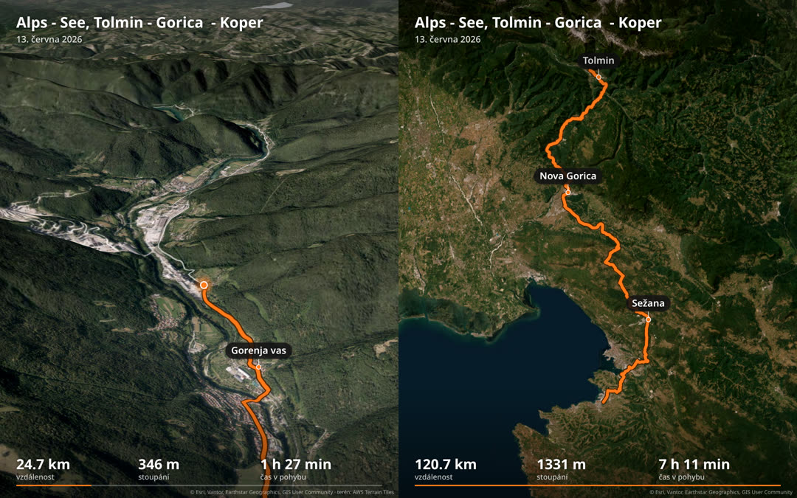

# Trail Flyover

[](https://github.com/zpracny/trail-flyover/actions/workflows/ci.yml)

**English** · [Česky](README.cs.md)

A smooth 3D fly-over of a GPS track: real-time preview in the browser and MP4/WebM video export
for social media. A framework-independent component built on MapLibre GL.



- **Smooth by construction.** The camera is a pure function of time, computed up front from a
  resampled and smoothed track. No keyframes, no per-frame waiting for the map.
- **The video is the preview.** Export renders the same flight frame by frame and waits for every
  map tile, so nothing is blurry or missing, however fast the flight.
- **Three modes:** 3D fly-over, a 2D map that follows the track, and a static view of the whole
  route where only the line runs.
- **Place names** only for places the track really passes, appearing as the trail reaches them.
- **No API keys.** Satellite, topographic and black-and-white basemaps work out of the box; an
  optional winter filter turns any of them snowy.

> The demo UI, the labels of the default stats panel and the error messages are in Czech for now.
> Apps normally draw their own panel (see [Custom HUD](#custom-hud)).

## Requirements

- **A browser** with WebGL 2, and WebCodecs for video export: Chrome, Edge, Firefox 130+, Safari 16.4+.
- **Node.js 22.18 or newer**: tests and scripts run straight from TypeScript, with no build step.
- **Python 3**, only for the demo server (`npm run serve`).
- No API keys or environment variables: every built-in basemap is keyless.

## Try it

```
git clone https://github.com/zpracny/trail-flyover.git && cd trail-flyover
npm ci
npm run build && npm run serve      # demo at http://127.0.0.1:8811
npm run check                       # types, linter (Biome) and tests
npm run compare                     # smoothness compared with a keyframe camera
```

Tests: 85 tests in about 10 s, on a real 121 km recording, a 46 km section of it, and synthetic and
random tracks. GitHub Actions runs the same checks on every push.

## Install into an app

The package is not on npm yet. Install it from GitHub; the app provides `maplibre-gl`:

```
npm install github:zpracny/trail-flyover maplibre-gl
```

The package ships TypeScript source (`src/index.ts`), so the app's bundler has to compile it.
Verified with esbuild (the demo). Vite and Next.js (`transpilePackages: ['trail-flyover']` in
`next.config`) should work the same way, but I have not tried them yet.

## Usage

```ts
import maplibregl from 'maplibre-gl';
import { TrailFlyover, parseGpx } from 'trail-flyover';

const fly = new TrailFlyover(element, {
    maplibregl,                                  // the app's own instance (no second copy)
    output: { width: 1080, height: 1920 },       // Story; Feed 1080×1350, Wide 1920×1080
    basemap: 'esri-satellite',                   // or 'cuzk-ortofoto', 'esri-light', your own BasemapDef…
    flight: { preset: 'drone', duration: 30 },   // drone | low | overview; camera: 'static' = whole route
    labels: [{ lon: 13.733, lat: 46.183, name: 'Tolmin', kind: 'town' }],   // only those on the route are shown
});
await fly.load(parseGpx(gpxText).points, { title: 'Tolmin – Koper', subtitle: '13 June 2026' });

fly.play();                                      // real-time preview
await fly.prefetch(p => console.log(p));         // optional: load tiles first, then playback has no holes
const video = await fly.exportVideo({ format: 'mp4', fps: 30, onProgress });
const photo = await fly.exportImage();
fly.on('time', t => …); fly.on('state', s => …);
fly.destroy();
```

### Calling it quickly and concurrently

The player expects to be called in quick succession (sliders, React effects):

- `load()` and `update()` are queued. With several `load()` calls in a row only the last track is
  built; the earlier calls finish without doing any work.
- `update()` may be called while `load()` is still running. An invalid change (unknown basemap,
  missing key) fails and changes nothing.
- During an export or a prefetch, `load()`, `update()` and another export fail with an error
  ("Probíhá export…", an export is in progress). `seek()` and `play()` are ignored in that time.
- `destroy()` may be called at any time, even in the middle of loading or exporting. A load in
  progress is dropped and no extra map is left behind; an export ends with `AbortError`.
- An unreachable or missing tile does not make `load()` fail. The map is completed when the tile
  arrives.

### Custom HUD

An app with its own look passes its own function instead of the default panel. The player keeps
drawing the place labels and the tip of the trail:

```ts
new TrailFlyover(el, {
    maplibregl,
    hud: (ctx, f) => {
        // f.width, f.height, f.scale (min(w,h)/1080), f.stats.distance / ascent / moving / elapsed,
        // f.total, f.progress, f.project(lon, lat) → a point in output pixels
        drawMyStats(ctx, f);
    },
});
```

### React / Next.js

The component works with the DOM and WebGL, so in Next.js it belongs in a client component:

```tsx
'use client';
import { useEffect, useRef } from 'react';
import maplibregl from 'maplibre-gl';
import 'maplibre-gl/dist/maplibre-gl.css';
import { TrailFlyover, type TrackPoint } from 'trail-flyover';

export function Flyover({ points, title }: { points: TrackPoint[]; title: string }) {
    const ref = useRef<HTMLDivElement>(null);
    const fly = useRef<TrailFlyover | null>(null);
    useEffect(() => {
        if (!ref.current) return;
        const f = new TrailFlyover(ref.current, { maplibregl });
        fly.current = f;
        f.load(points, { title }).catch(err => console.error(err));
        return () => {
            f.destroy();
            fly.current = null;
        };
    }, [points, title]);
    return <div ref={ref} style={{ width: '100%', aspectRatio: '4 / 5' }} />;
}
```

`destroy()` is safe in the middle of `load()`, so React running the effect twice in development
mode is not a problem.

## Three sharing modes (and a fourth)

They differ in just two options.

| Mode | What it does | Options |
|---|---|---|
| **Whole route** | the map stands still, the whole route is in view and only the line runs | `mode: '2d', flight: { camera: 'static' }` |
| **Map flight** | a 2D map glides along with the track, north up | `mode: '2d'` |
| **3D fly-over** | terrain, a tilted camera flies along the track | default |
| Whole route in 3D | a tilted view of the whole route with terrain, only the line runs | `flight: { camera: 'static' }` |

The static camera (`camera: 'static'`):

- The shot is computed exactly so that the whole route fits between the title and the stats panel.
- In 2D north is up. In 3D, or with `northUp: false`, the view turns when that makes the route
  considerably larger (an east–west route in the Story format).
- The video is shorter: 8 s + 0.15 s/km, at most 24 s. `intro` is how long the empty map is shown,
  `outro` how long the finished line stays.
- Small places disappear again after 3.5 s; towns stay as landmarks.

## Place names

Not every label passed in (`labels`) is shown. Only places the track really passes remain, and
each one appears at the moment the tip of the trail reaches it (not earlier).

- **Reach by kind of place** (`labelReach`, default `LABEL_REACH`): a town within 1,000 m (the
  point of a town is its centre and the track may pass along its edge), a village 400 m, a hamlet
  250 m, a peak 250 m, your own point (`kind: 'waypoint'`) 1,500 m. Pass one number for
  everything, or only some kinds: `labelReach: { village: 800 }`.
- **Pace** (`labelMinGap`, default 0.6 s): when places come in quick succession (a cluster of
  hamlets in a fast flight), the less important ones are left out. Towns always stay. `0` shows all.
- The place the track starts in is visible from the first frame.
- Where labels would overlap, the more important one wins, then the one passed earlier. They
  cross-fade instead of swapping abruptly; near the edge of the picture a label fades out.
- In the overview shots at both ends of a flight only towns remain.

On the Tolmin–Koper track (253 places from OpenStreetMap around it), 68 places are within reach;
a 60 s fly-over shows 31 of them, the 24 s static view 19.

`fetchPlaceLabels` gets names from OpenStreetMap through the Overpass API. Every server it asks
receives the bounding box of the track, i.e. roughly where the ride was. The default servers are
overpass-api.de (FOSSGIS, Germany), overpass.kumi.systems (Switzerland) and overpass.private.coffee
(Austria); pass your own list in `endpoints`. Overpass is often overloaded, so apps with their own
points of interest should pass them directly as `labels`.

## Basemaps

| id | Description | Key | Sharing the video | Tested |
|---|---|---|---|---|
| `esri-satellite` | Esri World Imagery, worldwide (summer imagery) | no | personal, non-commercial | ✅ |
| `cuzk-ortofoto` | ČÚZK orthophoto, the sharpest in Czechia (summer); Esri underneath beyond the border (`fallback`) | no | free (CC BY 4.0) | ✅ |
| `esri-wayback-2022` | Esri archive 2022: a real winter capture, but snow only in places (Špičák, Železná Ruda) | no | personal, non-commercial | ✅ |
| `esri-topo` | Esri topographic map, fast server | no | personal, non-commercial | ✅ |
| `opentopomap` | OpenTopoMap topographic map; slow server (a tile can take 8 s) | no | free (CC BY-SA) | ⚠️ slow |
| `esri-satellite-bw` | black-and-white satellite (the same Esri imagery without colour) | no | personal, non-commercial | ✅ |
| `esri-light` | black-and-white map: light grey base without labels, terrain as hillshade | no | personal, non-commercial | ✅ |
| `esri-dark` | dark base with hillshade | no | personal, non-commercial | ✅ |

No built-in basemap needs an API key. A keyed basemap of your own can be added through
`BasemapDef.requiresKey` and `apiKeys`. A custom basemap is a plain `BasemapDef` object (tile URLs,
attribution, colour adjustments). The HUD draws the attribution into the video too. Terrain always
comes from AWS Terrain Tiles (Terrarium, free).

### Licences and sharing the video (as of November 2026)

The "Sharing the video" column is also in the data (`BasemapDef.sharing`); the player blocks
nothing, the demo only shows a notice. This is not legal advice, just a summary of the terms I read.

- **ČÚZK orthophoto** has been open data under CC BY 4.0 since 1 July 2023. "© ČÚZK", which is in
  the video, is enough. The cleanest choice for Czechia.
- **Esri**: the terms for static maps (screen captures and the like) allow personal use and
  promoting your own products with attribution; "commercial monetization" needs permission. Video
  and social media are not mentioned explicitly. The layers (World Imagery, World Topo Map) are
  under the Esri Master License Agreement and, according to the terms on the items, are not meant
  for exporting tiles for offline use; fetching tiles as they are displayed during preview and
  video export is ordinary viewing. The attribution in the video matches what the services
  themselves declare.
- **Esri in production (to be verified):** the developer documentation for the current basemap
  services (Basemap Styles, Static Basemap Tiles) requires an ArcGIS Location Platform account and
  an access token. The `server.arcgisonline.com` URLs used here are not mentioned in it. For a
  public app with many users I therefore recommend an account and a token, with the basemaps
  passed as your own `BasemapDef` with `requiresKey`; I could not find out from the price list
  how much is free.
- **Mapy.com is deliberately not among the basemaps.** The API terms (from 1 June 2025, art. 4.6.2)
  forbid storing, exporting and sharing tiles and outputs, and the attribution requires a
  clickable logo above the map, which a video cannot have. Exporting video for social media would
  need written consent from Seznam.cz.
- **OpenTopoMap** is CC BY-SA, but the server is slow and not meant for bulk downloading.

Sources: [Mapy.com API terms](https://developer.mapy.com/terms-and-conditions/),
[Mapy.com attribution](https://developer.mapy.com/rest-api-mapy-cz/atribution/),
[Esri – static maps](https://doc.esri.com/en/arcgis-online/latest/reference/static-maps.html),
[Esri – Static Basemap Tiles](https://developers.arcgis.com/documentation/mapping-and-location-services/mapping/basemaps/introduction-static-basemap-tiles-service/),
[ČÚZK – open data](https://www.cuzk.gov.cz/Uvod/Produkty-a-sluzby/Otevrena-data/Otevrena-data-zakladni-informace.aspx).

### Snowy landscape

Continuous snowy aerial imagery in good resolution does not exist for free: Esri and ČÚZK fly in
summer, winter Sentinel-2 has 10 m/px and needs registration. I went through the Esri Wayback
archive automatically (199 releases). Only the 2021–2022 releases have a winter capture, and only
in places.

Hence the **winter filter** (`snow`), which covers any basemap in snow: meadows, fields and roofs
turn white, forests stay dark with hoarfrost and water stays dark. An optional snow line based on
the elevation model leaves the valleys green:

```ts
new TrailFlyover(el, { maplibregl, basemap: 'cuzk-ortofoto', snow: { snowline: 900 } });
fly.update({ snow: false });   // off
```

It works through a custom MapLibre protocol (`addProtocol`), so it can be switched on over any
basemap. The pixel conversion is a pure function, `snowifyPixels`, tested in Node.

## Why it is smooth

A typical keyframe camera (the comparison baseline is the 3D fly-over of the author's app
TrailMetrics, ported in `test/helpers/trailMetricsCamera.ts`) stutters for these reasons:

| Problem | Cause | Solution here |
|---|---|---|
| Rotation pulses | the heading is blended between 150 keyframes with smoothstep, so the angular velocity drops to zero at every keyframe (~5× per second) | no keyframes: the heading is the tangent of the smoothed path, smoothed again in time and limited to 32 °/s |
| The path has kinks | the centre is interpolated linearly between keyframes taken from raw GPS points | resampling at equal distances and zero-lag Gaussian smoothing, with a window proportional to the camera distance |
| The preview stutters | every frame waits for `GeoJSONSource.setData` (a worker, irregular timing) | the track is split into segments revealed through `feature-state` (synchronous); camera and `map.redraw()` in the same frame |
| The camera bobs | MapLibre takes the height of the centre from whatever terrain tiles are loaded | camera height from its own, pre-smoothed elevation model; `centerClampedToGround: false` |

Measured with `npm run compare` on the real track in `test/fixtures`:

| track, video | max. yaw acceleration: keyframes → here | path kink p99: keyframes → here |
|---|---|---|
| 121 km (Tolmin–Koper), 30 s | 358 → 16 °/s² | 29° → 1.0° per frame |
| 121 km (Tolmin–Koper), 60 s | 97 → 13 °/s² | 22° → 1.3° |

The intro and outro fly along a van Wijk–Nuij curve (the principle behind `flyTo`): the long move
happens at height and the zoom-in only near the target. Their length follows the zoom ratio (the
121 km track: 119 km → 7.3 km gets 6 s), so that the logarithmic zoom acceleration stays below
~0.6 /s².

**The tip of the trail stays in the frame.** The smoothed camera path cuts corners by up to 0.2 of
the camera distance. In the 9:16 format that is more than half the width of the picture, so the
tip used to leave the frame. Now the camera gently steps aside in such a place (the tip stays
within 58 % of the width) and flies 30 % further away in narrow formats. A test checks this for
all tracks, cameras and aspect ratios.

**The overview uses the whole picture.** The opening and closing shots normally look in the
direction of travel. But when an elongated route would lie across the picture (a north–south
route in the Story format), the camera turns by up to 90° so that the route is as large as
possible. The turn is spread over the whole intro or outro.

## Architecture

```
src/core/        pure computation, no DOM (tested in Node)
  flightPlan.ts  track → flight plan: poseAt(t), distanceAt(t), statsAt(t)
  geo.ts         projection, resampling, Gaussian smoothing, angles
  gpx.ts         GPX reader (no DOMParser): track points, name, named waypoints
  clean.ts       removal of GPS glitches (jumps, 0°/0°), tracks across the 180th meridian
  terrarium.ts   synchronous elevation model from AWS Terrarium tiles (free, keyless)
  urls.ts        cutting query strings (API keys) out of error messages
src/maplibre/
  player.ts      TrailFlyover: preview, prefetch, export
  basemaps.ts    basemaps as data
src/hud/hud.ts   place labels, tip of the trail, default stats panel
src/effects/     winter filter (recolouring tiles)
src/export/      frame-by-frame encoding through WebCodecs (mediabunny)
src/extras/      place names from OpenStreetMap (Overpass), optional
```

**The camera is a pure function of time.** The flight plan is computed once; then `poseAt(t)`
returns the position of the camera and its target. Preview and export call the same function, so
the video looks exactly like the preview.

A flight has three phases: an opening overview of the whole route, the flight behind the tip of
the trail with a smooth start and stop, and a closing overview with a slight orbit. The overviews
are computed exactly: a virtual camera projects every point of the track and a binary search
finds the closest distance at which the route fits between the title and the stats panel. A test
checks this property for all three aspect ratios.

The core (`buildFlightPlan`, also with `preset: 'topdown'` for 2D) can be used without the player,
for example to animate a track in an interactive map through `map.jumpTo`.

## Input data

- **Distance** is the exact sum over the original points of the recording (not over the smoothed
  path), so it matches what the recording app shows (120.7 km for the Tolmin–Koper test track).
- **Moving time** (`stats.moving`) leaves out the stops; `stats.elapsed` is the whole recorded
  time. Tolmin–Koper: 7 h 11 min moving out of 9 h 08 min. The default panel shows moving time.
- **GPS glitches** are removed before any computation: a jump away and back faster than 180 km/h,
  the point 0°/0°, impossible coordinates, and a lone first or last point far from the track. A
  jump that does not come back (a paused recording, a train) stays. Without timestamps jumps are
  not judged.
- Tracks across the 180th meridian and in the southern and western hemispheres work (tested).
- Named waypoints in the GPX (`parseGpx(...).waypoints`) can be used directly as labels.
- The GPX reader runs in linear time on any input, so a malformed or hostile file cannot freeze
  the page.

## Performance (measured on Intel Iris Xe, preview 720×900)

Measured on two tracks that are not part of the repository.

A 128 km track (2.8 km/s over the ground in a 60 s video): rendering a frame with tiles loaded has
a median of 6 ms, but in real time the constant stream of new tiles keeps the preview at 30–46 fps
(25–38 fps with the winter filter). Export is always frame by frame and smooth. The tile cache is
therefore sized by track length (350 + 8 per km, at most 1,500).

A 51 km track:

- Computing one frame (camera, trail, HUD) takes under 1 ms. Rendering in MapLibre with cached
  tiles has a p95 of 4.9 ms.
- Real-time playback: around 64 fps, 0.4 % dropped frames (over 34 ms).
- The preview renders only at the resolution it is displayed at. Full resolution is switched on
  for export.
- By default MapLibre keeps only ~85 tiles in its cache (5× the number in view). The player
  therefore raises `maxTileCacheZoomLevels`, and the default `maxTileCacheSize` is 350. With 3,000
  playback was slower.
- Export 1080×1350, 30 fps, 37.6 s: 84 s of rendering, H.264 High, ~8.6 Mbit/s, no duplicated
  frames. Every frame waits for all tiles, so the video is not blurry even in a fast flight.
- Export of the Tolmin–Koper track (before the test file was trimmed, 124 km) 1080×1920, 30 fps,
  60 s (1,801 frames): 106 s, H.264 High, 12.4 Mbit/s, 93 MB, no frozen frame. Waiting for tiles
  no longer costs a fixed 60 ms per frame: when nothing is missing, rendering continues at once.
  Verified on 140 camera jumps; not once was a tile left unloaded.
- Preview of the Tolmin–Koper track (4:5, tiles already in the browser cache): 62 fps, 5.7 % of
  frames over 25 ms.

## Limitations and next steps

- Export needs WebCodecs (Chrome, Edge, Firefox 130+, Safari 16.4+). MP4 with H.264 is preferred,
  otherwise HEVC, AV1 or VP9 is used.
- The demo UI, default panel labels and error messages are in Czech.
- Mobile devices will need a smaller tile cache and probably a lower export resolution.
- The winter filter runs on the main thread. Moving it to a Web Worker would speed up the first
  pass on long tracks.
- Very long tracks would benefit from variable speed: slower in the mountains and near the
  finish, faster on the flat.
- The package ships TypeScript source; a compiled build with type declarations is planned.

## Security

The library has no server and no accounts. [SECURITY.md](SECURITY.md) describes what it sends to
third parties and how to report a vulnerability.

## Licence

The code is under the MIT licence (see `LICENSE`).

- Dependencies: MapLibre GL JS (BSD-3-Clause), mediabunny (MPL-2.0).
- Map tiles are not part of the project and are subject to their providers' terms (see "Licences
  and sharing the video"). Elevation model: AWS Terrain Tiles.
- Place names in `test/fixtures/*.places.json`: © OpenStreetMap contributors (ODbL), see
  [test/fixtures/README.md](test/fixtures/README.md).
- The GPX file in `test/fixtures` is the author's own recording, included as test data. For
  privacy it starts and ends a kilometre away from the real start and finish, and its date is
  shifted (the times of day are real).
